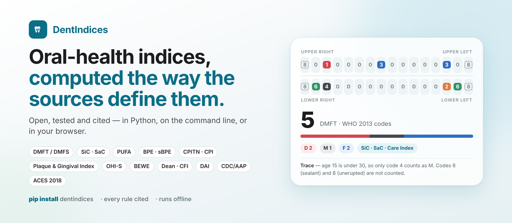

<p align="center">
  
</p>

# DentIndices

**Oral-health epidemiology indices with cited, tested rules.** DentIndices computes the indices used
in dental surveys, trials and clinics — **DMFT/DMFS** (WHO 2013), **SiC**, **SaC**, care and
restorative indices, **PUFA**, **BPE** and the under-18 **sBPE**, **CPITN**, the WHO 2013 **CPI** and
**loss of attachment**, the **Plaque** and **Gingival Index**, **O'Leary's Plaque Control Record**,
**OHI-S**, **BEWE**, **Dean's fluorosis index** and the **Community Fluorosis Index**, the **Dental
Aesthetic Index**, and the **CDC/AAP** and **ACES** (2018 classification) periodontitis case
definitions. Every rule traces to the publication it comes from, every result explains how it was
reached, and the same engine runs in Python and in your browser.

[](https://pypi.org/project/dentindices/)
[](https://pypi.org/project/dentindices/)
[](https://github.com/Hezarani/dentindices/blob/main/LICENSE)
[](https://github.com/Hezarani/dentindices/actions/workflows/tests.yml)
[](https://hezarani.github.io/dentindices/)
[](https://github.com/Hezarani/dentindices/blob/main/pyproject.toml)

> **Research, teaching and survey tool.** DentIndices computes indices from findings an examiner has
> already recorded; it does not examine anyone, diagnose anyone or replace clinical judgement.
> Guidance text (for example the BSP's BPE recommendations) is quoted from its source for context.

---

## Why this exists

Oral-health indices look simple, and that is the problem. DMFT is "decayed + missing + filled
teeth", but WHO 2013 counts a tooth missing for a non-caries reason only from age 30, excludes
sealants, crowns that are bridge abutments and unerupted teeth, and has rules for a primary and a
permanent tooth in the same space. The Significant Caries Index needs a rule for rounding one third
of a sample. ACES, the 2024 framework that applies the 2018 periodontitis classification to survey
data, has different flowcharts for completed and planned surveys and leaves several details to
interpretation. Every research group re-implements these rules in its own spreadsheet or script,
small differences go unreported, and results from different studies are quietly not comparable.

DentIndices puts those rules in one place, in the open, and makes each decision visible:

- **One cited registry.** Every code table, threshold and interpretation band lives in a single
  machine-readable file, [`indices.json`](https://github.com/Hezarani/dentindices/blob/main/dentindices/data/indices.json), next to the publication it
  comes from. Each index is marked **primary** (the original paper or manual was read) or
  **secondary** (the original is not openly available in full; the rule was checked against its
  abstract and/or independent publications that restate it, which the registry names).
- **Disagreements are documented, not hidden.** Where sources are silent or disagree — the DAI band
  boundary at 25, rounding the SiC third, the CFI score for "questionable", what "non-adjacent"
  means in ACES — the [registry](https://github.com/Hezarani/dentindices/blob/main/dentindices/data/indices.json) and the
  [index reference](https://github.com/Hezarani/dentindices/blob/main/docs/INDICES.md) record the issue and the choice made. Change the choice with an
  option, not by editing code.
- **Every result explains itself.** Each function returns the value, its components, the
  interpretation band, the source's guidance, warnings about the data and a step-by-step trace of the
  calculation, plus the references to cite.
- **Two engines, one answer.** A dependency-free Python package and a JavaScript engine for the
  browser read the same registry; thousands of randomised cases are compared on every test run so the
  web app and the package always agree.
- **Built for whole surveys.** Read a CSV laid out like the WHO 2013 assessment form (one row per
  person, a column per tooth), compute an index for every person, then get group summaries — n,
  mean, SD, SE, t-based 95% CI, median, prevalence with a Wilson CI, SiC and SaC — and care and
  restorative indices, in three lines of Python or by dropping the file onto the web app.

## Three ways to use it

### 1. In the browser — nothing to install

**[hezarani.github.io/dentindices](https://hezarani.github.io/dentindices/)** has a calculator for
every index family (a tappable WHO-coded odontogram for DMFT, sextant grids for BPE, CPITN and
BEWE, a six-site chart for CDC/AAP and ACES, and more) and a **survey** tab that processes a whole
CSV file. Everything runs on your device: there is no server, no upload, no cookies and no analytics
(the page's content-security policy forbids network requests).

### 2. In Python

```bash
pip install dentindices
```

```python
import dentindices as di

# DMFT from WHO 2013 codes (0 sound, 1 caries, 2 filled with caries, 3 filled, 4 missing due to caries ...)
r = di.dmft_permanent({16: "1", 26: "3", 36: "4", 46: "0", 11: "0"}, age=15)
r.value                 # 3
r.components["DT"]      # 1
r.trace[1]              # 'M rule (WHO 2013): age 15 is under 30, so only code 4 counts.'
r.references()          # full references to cite

# BPE (BSP 2019): one code per sextant, '*' for furcation involvement, '-' for an excluded sextant
b = di.bpe({"UR": "3", "UA": "1", "UL": "4*", "LL": "2", "LA": "2", "LR": "-"})
b.category              # 'Code 4*'
b.guidance              # BSP recommendation for the highest code

# ACES (2018 classification for surveys) from a six-site chart
chart = di.perio_chart({16: {"pd": {"MB": 6, "DB": 5}, "cal": {"MB": 6, "DB": 5}}, ...})
di.aces(chart, age=52, cigarettes_per_day=12).category
```

**A whole survey** — one row per person, a column per tooth (`17`, `16`, … or `55`, `54`, …),
WHO 2013 codes in the cells:

```python
rows = di.read_csv("caries_survey.csv")
people = di.batch(rows, "dmft_permanent")              # one result row per person, errors recorded per row
table = di.summary_table(people, "DMFT", by="age_group")  # n, mean, SD, CI, prevalence, SiC, SaC per group
di.write_csv(people, "caries_results.csv")
```

Long-format periodontal charts (`id, tooth, site, pd, cal, bop`, plus optional person-level columns
such as `age`, `cigarettes_per_day`, `diabetes`, `hba1c` and `teeth_present`) go through
`di.batch_perio(rows)`, which returns CDC/AAP, ACES and the continuous summary measures for every
person (`survey="planned"` for the ACES planned-survey flowchart; `cdc_options={...}` for the CDC/AAP
reading options).

CSV files may use commas, semicolons or tabs and any line ending; UTF-8 is expected, and files saved
by older spreadsheet programs in Windows-1252 or Turkish Windows-1254 are recognised automatically
(`read_csv(path, encoding=...)` to choose).

### 3. On the command line

```bash
dentindices list                                   # every index, its sources and verification level
dentindices cite aces                              # references to cite for an index
dentindices dmft "16=1,26=3,36=4,46=0" --age 15   # one person
dentindices examples ./examples                    # write the synthetic example files
dentindices batch dmft_permanent caries_survey.csv -o results.csv
dentindices summary results.csv --column DMFT --by age_group
dentindices perio perio_chart_long.csv -o perio_results.csv   # --survey planned, --mild-pd5-any-site ...
```

## What is included

| Family | Index | Function | Sources | Checked against |
|---|---|---|---|---|
| Caries | DMFT, permanent teeth | `dmft_permanent()` | WHO 2013, WHO 1997, Klein et al. 1938 | primary |
| Caries | dmft, primary teeth | `dmft_primary()` | WHO 2013 | primary |
| Caries | DMFS, permanent surfaces | `dmfs_permanent()` | WHO 2013, Broadbent & Thomson 2005 | primary |
| Caries | dmfs, primary surfaces | `dmfs_primary()` | WHO 2013 | primary |
| Caries | PUFA/pufa | `pufa()` | Monse et al. 2010 | secondary |
| Caries | Significant Caries Index (SiC, SiC10) | `sic()` | Bratthall 2000, Nishi et al. 2002 | secondary |
| Caries | Specific affected Caries Index (SaC) | `sac()` | Schmoeckel et al. 2019 | secondary |
| Caries | Care Index (FT/DMFT) | `care_index()` | Walsh 1970, Gupta et al. 2017 | secondary |
| Caries | Restorative Index (FT/(DT+FT)) | `restorative_index()` | Jackson 1973, Gupta et al. 2017 | secondary |
| Caries | WHO caries-experience levels (12 and 35–44 years) | `who_caries_level()` | WHO 2013 | primary |
| Periodontal screening | Basic Periodontal Examination (BPE) | `bpe()`, `bpe_from_teeth()` | BSP 2019 | primary |
| Periodontal screening | Simplified BPE for under-18s (sBPE) | `sbpe()` | BSP/BSPD 2021 | primary |
| Periodontal screening | CPITN (1982) / CPI (WHO 1997) | `cpitn()` | Ainamo et al. 1982, WHO 1997 | secondary |
| Periodontal screening | CPI modified: gingival bleeding and pockets (WHO 2013) | `cpi_modified()` | WHO 2013 | primary |
| Periodontal screening | Loss of attachment (WHO 2013) | `loss_of_attachment()` | WHO 2013 | primary |
| Hygiene & gingiva | Plaque Index (Silness & Löe) | `plaque_index()` | Silness & Löe 1964, Löe 1967 | secondary |
| Hygiene & gingiva | Gingival Index (Löe & Silness) | `gingival_index()` | Löe & Silness 1963, Löe 1967 | secondary |
| Hygiene & gingiva | Plaque Control Record (O'Leary) | `plaque_control_record()` | O'Leary et al. 1972 | secondary |
| Hygiene & gingiva | Simplified Oral Hygiene Index (OHI-S) | `ohi_s()` | Greene & Vermillion 1964 | primary |
| Tooth wear | Basic Erosive Wear Examination (BEWE) | `bewe()`, `bewe_from_teeth()` | Bartlett et al. 2008, Aránguiz et al. 2020 | primary |
| Fluorosis | Dean's index (person score) | `dean_index()` | WHO 2013, Dean 1934, 1942 | primary |
| Fluorosis | Community Fluorosis Index | `community_fluorosis_index()` | Dean 1942, WHO 2013 | secondary |
| Occlusion | Dental Aesthetic Index (DAI) | `dai()` | Cons et al. 1986, Jenny & Cons 1996, WHO 1997 | primary |
| Periodontitis | CDC/AAP surveillance case definitions | `cdc_aap()` | Page & Eke 2007, Eke et al. 2012 | primary |
| Periodontitis | ACES: 2018 classification for survey data (stage, extent, grade) | `aces()` | Holtfreter et al. 2024, Tonetti et al. 2018, Papapanou et al. 2018, Chapple et al. 2018 | primary |
| Periodontitis | Continuous measures (mean PD/CAL, % sites over thresholds) | `perio_summary()` | Holtfreter et al. 2015, 2024 | primary |
| Population | Summary statistics (mean, CI, prevalence with Wilson CI) | `summarize()`, `summary_table()` | — | — |

The full specification of each index — codes, rules, edge cases and the choices made where sources
are silent — is in **[docs/INDICES.md](https://github.com/Hezarani/dentindices/blob/main/docs/INDICES.md)**.

### How each result looks

```text
>>> print(di.bewe({"S1": 2, "S2": 1, "S3": 3, "S4": 0, "S5": 1, "S6": 2}))
Basic Erosive Wear Examination (BEWE): 9 (Medium)
  BEWE: 9
  risk_level: Medium
  sextants_scored: 6
  max_sextant_score: 3
  repeat: Repeat at 6-12-month intervals.
  guidance: Oral hygiene and dietary assessment and advice; identify the main aetiological factor(s) ...
  warning: The authors state the cut-off values are based on experience and have to be reconsidered.
```

`IndexResult` also carries `components` (every part of the calculation), `guidance` (what the
source recommends for that band), `warnings` (for example a missing age for the M rule, or a sextant
with too few teeth), `trace` (each step in plain language) and `sources`. `result.row()` flattens it
for a data frame; `result.to_dict()` gives JSON.

## How it was checked

- **Against the sources.** Each code table and threshold was transcribed from the original
  publication or manual and cross-checked; where an original is not openly available in full, its
  abstract and/or independent publications that restate the rule were used, and the index is marked
  `secondary`. An independent review checked every DOI against Crossref and the definitions against
  the openly available sources before release. Worked examples from the sources (Schmoeckel's SaC illustration, the OHI-S worked
  example, the DAI regression weights) are unit tests.
- **Edge cases.** Mixed dentition, a primary tooth and its successor coded in the same space, code 5
  before and after age 30, third molars replacing missing second molars (BEWE, BPE), sextants with
  fewer than two teeth, edentulous people, charts with too few teeth for CDC/AAP, both ACES survey
  flowcharts, grade modifiers that can only raise the grade.
- **Python ↔ JavaScript parity.** The browser engine is a line-for-line port. Every test run sends
  2,100 randomised inputs through both engines and requires identical output (values, categories,
  warnings and traces), plus the batch and survey-summary functions on the example files.
- **Synthetic examples only.** The example data (`dentindices examples`) are generated with a fixed
  seed by [`scripts/make_examples.py`](https://github.com/Hezarani/dentindices/blob/main/scripts/make_examples.py); no real patient data are included.

Run the 261 tests yourself with `pip install -e ".[test]"` and `python -m pytest`.

## Choices where the sources leave room

A few rules need a decision that the sources do not make, or make differently. DentIndices states
each one, uses the most defensible default and lets you change it:

| Index | Issue | Default |
|---|---|---|
| SiC | Size of "one third" when n is not divisible by 3 | Nearest integer (Bratthall's example); `rounding="ceil"`, `"floor"` or `"fractional"` available |
| DMFT | Third molars; code 5 without an age | Third molars included (WHO); `include_third_molars=False` available. Code 5 not counted, with a warning, when age is missing |
| DAI | WHO 1997 prints the lowest band as "< 25", leaving 25 unassigned | ≤ 25 "no or minor malocclusion" (Jenny & Cons 1996) |
| CFI | Public-health bands share their end points | Each band includes its upper end point (0.6 is borderline; above 0.6 is a public-health problem) |
| BEWE | "The adjacent sextant" for a single remaining tooth | Posterior → anterior sextant of the same arch; anterior → posterior sextant on the same side |
| CDC/AAP | Whether the two mild CAL sites must be on different teeth | Yes (as for moderate and severe); `mild_cal_distinct_teeth=False` available |
| CDC/AAP | Whether "one site with PD ≥ 5 mm" (mild) must be interproximal | Yes, like every other criterion; `mild_pd5_any_site=True` available |
| WHO caries levels | Strict outer limits but one-decimal inner bands with gaps (2.6–2.7) | Unrounded mean against the printed limits; only means in a gap are read to one decimal |
| ACES | Extent "at the stage-defining severity level"; "non-adjacent" across gaps; buccal/oral-only cases; non-classified rule; stage IV complexity in planned surveys; relative CAL for grading | Documented in the registry, with a warning in the result when they apply |

The complete list, with sources, is in the `discrepancies` section of
[`indices.json`](https://github.com/Hezarani/dentindices/blob/main/dentindices/data/indices.json) and in [docs/INDICES.md](https://github.com/Hezarani/dentindices/blob/main/docs/INDICES.md).

## How DentIndices relates to existing tools

| | DentIndices | [tooth](https://CRAN.R-project.org/package=tooth) (R, 2026) | Spreadsheets and online calculators |
|---|---|---|---|
| Caries indices (DMFT/DMFS) | WHO 2013 codes natively | Yes, from ICDAS/surface data, with odontogram heatmaps | Usually one index, one rule set |
| Periodontal, hygiene, wear, fluorosis, occlusion | Yes (BPE, sBPE, CPITN, CPI, LOA, PlI, GI, PCR, OHI-S, BEWE, Dean, CFI, DAI) | No | Scattered, rarely cited |
| CDC/AAP and ACES case definitions | Yes, both ACES flowcharts | No | Not found (older CDC definitions: RPerio, see below) |
| Survey summaries (SiC, SaC, care index, CIs) | Yes | Stratified means and tests | Manual |
| Rules traceable to sources | Registry with citations, verification level and documented discrepancies | Documented in the package | Rarely |
| Runs in a browser, offline, no upload | Yes | No | Often server-side |

`tooth` (Selvaraj & Nelson) is the closest open package and is stronger for caries data recorded at
ICDAS/surface level and for publication odontograms; the two are complementary. For periodontitis,
the experimental R package [RPerio](https://github.com/Kagereki/RPerio) (Kagereki 2015) implemented
the CDC working-group (2007/2010) and 5th European Workshop case definitions. We found no packaged
open implementation of ACES.

## Limitations

- DentIndices computes indices from recorded findings; it cannot check that the examination was
  calibrated or that codes were assigned correctly.
- ACES is applied to whatever chart is supplied. It was designed for full-mouth or partial-mouth
  protocols with interdental sites; with partial recording, prevalence is underestimated, as its
  authors note. **With a partial-mouth chart, give `teeth_present`** (a `teeth_present` column in
  survey files): otherwise uncharted teeth count as missing and the fewer-than-10-pairs rule can
  raise the stage to IV (the result warns when this may have happened). CDC/AAP was designed for
  full-mouth, six-site data.
- Interpretation bands marked as conventions (for example good/fair/poor for OHI-S, or bands for
  the Plaque and Gingival Index) are textbook conventions, not part of the original indices; the
  result warns when it reports one.
- Survey statistics are unweighted unless weights are given, and the weighted option gives point
  estimates only; use survey software for design-based confidence intervals.
- English only in this release.

## Repository structure

```text
dentindices/            Python package (no dependencies)
  data/indices.json     the cited registry: codes, thresholds, bands, sources, discrepancies
  data/examples/        synthetic example surveys
docs/                   the web app (GitHub Pages): index.html, app.js, dentindices.js (engine)
docs/INDICES.md         full specification of every index
scripts/                build the web app's data files and the example surveys
tests/                  261 tests, including Python <-> JavaScript parity
paper.md, paper.bib     short software paper (JOSS format)
```

## References & prior work

These are the publications DentIndices implements, the reviews used to check rules whose originals
are not openly available, and the prior software it builds on or complements.

**Survey methods and caries**

- World Health Organization (Petersen PE, Baez RJ) (2013). *Oral health surveys: basic methods*, 5th ed. Geneva: WHO. [iris.who.int/handle/10665/97035](https://iris.who.int/handle/10665/97035)
- World Health Organization (1997). *Oral health surveys: basic methods*, 4th ed. Geneva: WHO. [iris.who.int/handle/10665/41905](https://iris.who.int/handle/10665/41905)
- Klein H, Palmer CE, Knutson JW (1938). Studies on dental caries. I. Dental status and dental needs of elementary school children. *Public Health Reports* 53(19):751–765. [doi:10.2307/4582532](https://doi.org/10.2307/4582532)
- Broadbent JM, Thomson WM (2005). For debate: problems with the DMF index pertinent to dental caries data analysis. *Community Dent Oral Epidemiol* 33(6):400–409. [doi:10.1111/j.1600-0528.2005.00259.x](https://doi.org/10.1111/j.1600-0528.2005.00259.x)
- Bratthall D (2000). Introducing the Significant Caries Index together with a proposal for a new global oral health goal for 12-year-olds. *Int Dent J* 50(6):378–384. [doi:10.1111/j.1875-595X.2000.tb00572.x](https://doi.org/10.1111/j.1875-595X.2000.tb00572.x)
- Nishi M, Stjernswärd J, Carlsson P, Bratthall D (2002). Caries experience of some countries and areas expressed by the Significant Caries Index. *Community Dent Oral Epidemiol* 30(4):296–301. [doi:10.1034/j.1600-0528.2002.00054.x](https://doi.org/10.1034/j.1600-0528.2002.00054.x)
- Schmoeckel J, Santamaría RM, Basner R, Schüler E, Splieth CH (2019). Introducing a specific term to present caries experience in populations with low caries prevalence: Specific Affected Caries Index (SaC). *Caries Res* 53(5):527–531. [doi:10.1159/000496932](https://doi.org/10.1159/000496932)
- Walsh J (1970). International patterns of oral health care: the example of New Zealand. *N Z Dent J* 66(304):143–152. [PMID 4392915](https://pubmed.ncbi.nlm.nih.gov/4392915/)
- Jackson D (1973). Measuring restorative dental care in communities. *Br Dent J* 134(9):385–388. [doi:10.1038/sj.bdj.4803007](https://doi.org/10.1038/sj.bdj.4803007)
- Gupta E, Innes N, Schuller AA, Vermaire JH, Marshman Z (2017). A scoping review of the uses of the care index in children. *Community Dent Health* 34(3):131–136. [doi:10.1922/CDH_4063Gupta06](https://doi.org/10.1922/CDH_4063Gupta06)
- Monse B, Heinrich-Weltzien R, Benzian H, Holmgren C, van Palenstein Helderman W (2010). PUFA: an index of clinical consequences of untreated dental caries. *Community Dent Oral Epidemiol* 38(1):77–82. [doi:10.1111/j.1600-0528.2009.00514.x](https://doi.org/10.1111/j.1600-0528.2009.00514.x)

**Periodontal screening**

- British Society of Periodontology (2019). *Basic Periodontal Examination (BPE)*. [bsperio.org.uk](https://www.bsperio.org.uk/assets/downloads/BSP_BPE_Guidelines_2019.pdf)
- Clerehugh V, Kindelan S (BSP/BSPD) (2021). *Guidelines for periodontal screening and management of children and adolescents under 18 years of age* (executive summary, updated 2021). [bsperio.org.uk](https://www.bsperio.org.uk/assets/downloads/Executive_Summary_Simplified_BPE_for_the_Under_18s__BSP_BSPD_updated_2021_FINAL_PDF_version_130721.pdf)
- Ainamo J, Barmes D, Beagrie G, Cutress T, Martin J, Sardo-Infirri J (1982). Development of the World Health Organization (WHO) community periodontal index of treatment needs (CPITN). *Int Dent J* 32(3):281–291. [PMID 6958657](https://pubmed.ncbi.nlm.nih.gov/6958657/)

**Hygiene and gingival indices**

- Silness J, Löe H (1964). Periodontal disease in pregnancy. II. Correlation between oral hygiene and periodontal condition. *Acta Odontol Scand* 22:121–135. [doi:10.3109/00016356408993968](https://doi.org/10.3109/00016356408993968)
- Löe H, Silness J (1963). Periodontal disease in pregnancy. I. Prevalence and severity. *Acta Odontol Scand* 21:533–551. [doi:10.3109/00016356309011240](https://doi.org/10.3109/00016356309011240)
- Löe H (1967). The Gingival Index, the Plaque Index and the Retention Index systems. *J Periodontol* 38(6):610–616. [doi:10.1902/jop.1967.38.6.610](https://doi.org/10.1902/jop.1967.38.6.610)
- O'Leary TJ, Drake RB, Naylor JE (1972). The plaque control record. *J Periodontol* 43(1):38. [doi:10.1902/jop.1972.43.1.38](https://doi.org/10.1902/jop.1972.43.1.38)
- Greene JC, Vermillion JR (1964). The Simplified Oral Hygiene Index. *J Am Dent Assoc* 68:7–13. [doi:10.14219/jada.archive.1964.0034](https://doi.org/10.14219/jada.archive.1964.0034)
- D'Elia G, Floris W, Marini L, et al. (2023). Methods for evaluating the effectiveness of home oral hygiene measures: a narrative review of dental biofilm indices. *Dent J* 11(7):172. [doi:10.3390/dj11070172](https://doi.org/10.3390/dj11070172)

**Tooth wear, fluorosis and occlusion**

- Bartlett D, Ganss C, Lussi A (2008). Basic Erosive Wear Examination (BEWE): a new scoring system for scientific and clinical needs. *Clin Oral Investig* 12(Suppl 1):S65–S68. [doi:10.1007/s00784-007-0181-5](https://doi.org/10.1007/s00784-007-0181-5)
- Aránguiz V, Lara JS, Marró ML, O'Toole S, Ramírez V, Bartlett D (2020). Recommendations and guidelines for dentists using the basic erosive wear examination index (BEWE). *Br Dent J* 228(3):153–157. [doi:10.1038/s41415-020-1246-y](https://doi.org/10.1038/s41415-020-1246-y)
- Dean HT (1934). Classification of mottled enamel diagnosis. *J Am Dent Assoc* 21(8):1421–1426. [doi:10.14219/jada.archive.1934.0220](https://doi.org/10.14219/jada.archive.1934.0220)
- Dean HT (1942). The investigation of physiological effects by the epidemiological method. In: Moulton FR (ed.), *Fluorine and Dental Health*. Washington DC: AAAS, pp. 23–31.
- Cons NC, Jenny J, Kohout FJ (1986). *DAI: the Dental Aesthetic Index*. Iowa City: College of Dentistry, University of Iowa.
- Jenny J, Cons NC (1996). Establishing malocclusion severity levels on the Dental Aesthetic Index (DAI) scale. *Aust Dent J* 41(1):43–46. [doi:10.1111/j.1834-7819.1996.tb05654.x](https://doi.org/10.1111/j.1834-7819.1996.tb05654.x)

**Periodontitis case definitions**

- Page RC, Eke PI (2007). Case definitions for use in population-based surveillance of periodontitis. *J Periodontol* 78(7 Suppl):1387–1399. [doi:10.1902/jop.2007.060264](https://doi.org/10.1902/jop.2007.060264)
- Eke PI, Page RC, Wei L, Thornton-Evans G, Genco RJ (2012). Update of the case definitions for population-based surveillance of periodontitis. *J Periodontol* 83(12):1449–1454. [doi:10.1902/jop.2012.110664](https://doi.org/10.1902/jop.2012.110664)
- Holtfreter B, Kuhr K, Borof K, et al. (2024). ACES: a new framework for the application of the 2018 periodontal status classification scheme to epidemiological survey data. *J Clin Periodontol* 51(5):512–521. [doi:10.1111/jcpe.13965](https://doi.org/10.1111/jcpe.13965)
- Tonetti MS, Greenwell H, Kornman KS (2018). Staging and grading of periodontitis: framework and proposal of a new classification and case definition. *J Clin Periodontol* 45(Suppl 20):S149–S161. [doi:10.1111/jcpe.12945](https://doi.org/10.1111/jcpe.12945)
- Papapanou PN, Sanz M, et al. (2018). Periodontitis: consensus report of workgroup 2 of the 2017 World Workshop on the Classification of Periodontal and Peri-Implant Diseases and Conditions. *J Clin Periodontol* 45(Suppl 20):S162–S170. [doi:10.1111/jcpe.12946](https://doi.org/10.1111/jcpe.12946)
- Chapple ILC, Mealey BL, et al. (2018). Periodontal health and gingival diseases and conditions on an intact and a reduced periodontium: consensus report of workgroup 1 of the 2017 World Workshop on the Classification of Periodontal and Peri-Implant Diseases and Conditions. *J Clin Periodontol* 45(Suppl 20):S68–S77. [doi:10.1111/jcpe.12940](https://doi.org/10.1111/jcpe.12940)
- Sanz M, Herrera D, Kebschull M, et al. (2020). Treatment of stage I–III periodontitis: the EFP S3 level clinical practice guideline. *J Clin Periodontol* 47(Suppl 22):4–60. [doi:10.1111/jcpe.13290](https://doi.org/10.1111/jcpe.13290)
- Tay JRH, Holtfreter B, Baumeister SE, Peres MA, Nascimento GG (2025). Application of the 2018 Periodontal Status Classification to Epidemiological Survey Data (ACES) framework to estimate the periodontitis prevalence in the United States. *J Clin Periodontol* 52(7):1032–1043. [doi:10.1111/jcpe.14132](https://doi.org/10.1111/jcpe.14132)
- Holtfreter B, Albandar JM, Dietrich T, et al. (2015). Standards for reporting chronic periodontitis prevalence and severity in epidemiologic studies: proposed standards from the Joint EU/USA Periodontal Epidemiology Working Group. *J Clin Periodontol* 42(5):407–412. [doi:10.1111/jcpe.12392](https://doi.org/10.1111/jcpe.12392)

**Prior software**

- Selvaraj D, Nelson S (2026). *tooth: Dental Public Health Indices and Odontogram Visualizations*. R package version 0.5.0. [doi:10.32614/CRAN.package.tooth](https://doi.org/10.32614/CRAN.package.tooth)
- Kagereki EM (2015). *RPerio: tools for case definitions and prevalences in population-based surveillance of periodontitis*. R package version 1.0. [github.com/Kagereki/RPerio](https://github.com/Kagereki/RPerio)
- Boustani Hezarani H (2026). *ToothNotation*, *PerioRisk* and other DentGit packages — tooth-numbering conversion and periodontal tools from the same author. [github.com/Hezarani](https://github.com/Hezarani)

## Citation and licence

If DentIndices helps your work, please cite the software (see [`CITATION.cff`](https://github.com/Hezarani/dentindices/blob/main/CITATION.cff) or the
"Cite this repository" button on GitHub) **and the original publication of each index you use** —
`dentindices cite <index>` or `result.references()` prints them.

> Boustani Hezarani, H. (2026). *DentIndices: open, tested oral-health epidemiology indices*
> (Version 1.0.0) [Computer software]. https://github.com/Hezarani/dentindices

Released under the [MIT licence](https://github.com/Hezarani/dentindices/blob/main/LICENSE). Index definitions belong to their authors; DentIndices
re-implements the published rules and quotes short guidance texts for reference.

Author: **Hossein Boustani Hezarani**, DDS — independent researcher, Ankara, Türkiye ·
ORCID [0009-0007-8481-0498](https://orcid.org/0009-0007-8481-0498)
